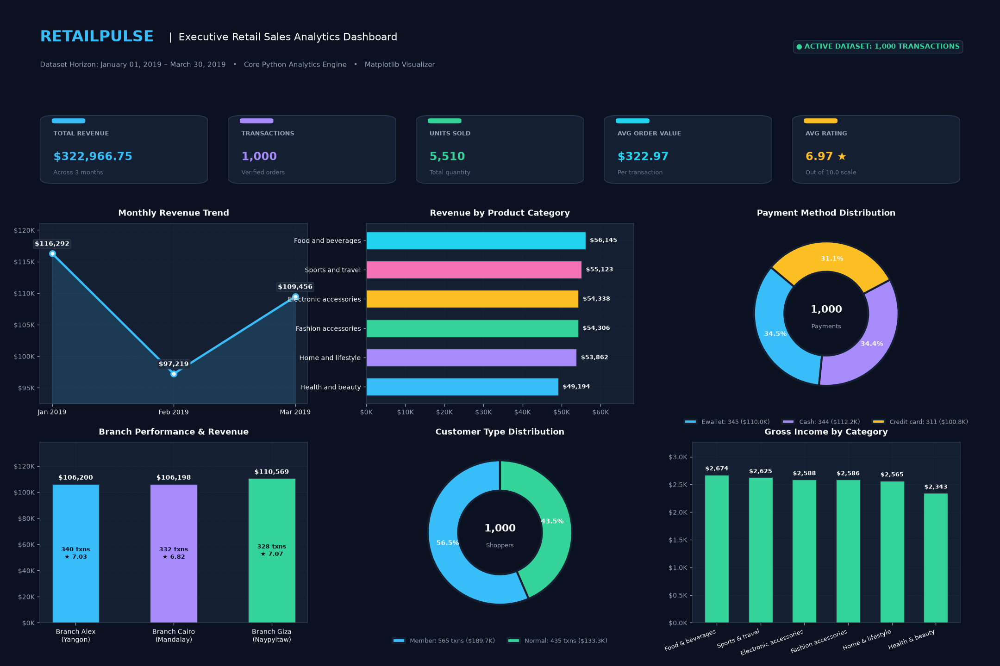

# RetailPulse 📊

> **Retail Sales Analytics Dashboard**  
> *Subject:* Python Programming (Semester 3)  
> *Developer:* Kartikeya Pradhan (Undergraduate CSE)  
> *Platform:* macOS (Apple Silicon M4) | Python 3.14+

---

## 📌 Project Overview

**RetailPulse** is an academic retail sales analytics application designed to analyze supermarket transactional data using core Python programming concepts. It processes historical sales records and delivers insights through both an interactive terminal menu and a dark, modern visual analytics dashboard powered by Matplotlib.

### Core Objectives
1. **Core Python Data Processing:** Read, validate, clean, and aggregate transactional data using Python's standard library (`csv`, `datetime`, `pathlib`, dictionaries, and lists) without relying on heavy data science frameworks like Pandas.
2. **Interactive Command-Line Interface:** An intuitive, fault-tolerant terminal menu enabling targeted analytical queries and summary views.
3. **Executive Visual Dashboard:** A multi-chart dark-themed dashboard displaying key performance indicators (KPIs) and operational trends.

---

## 🛠️ Technology Stack & Constraints

- **Language:** Python 3 (Tested on Python 3.14)
- **Data Ingestion:** Built-in `csv` module (`csv.DictReader`)
- **Date Handling:** Standard library `datetime`
- **Data Structures:** Native Python dictionaries, lists, sets, and tuples
- **Data Visualization:** `matplotlib` (Dark Navy / Modern theme)
- **Path Management:** Standard library `pathlib`
- **Testing:** Standard library `unittest`

### Architectural Constraints
- ❌ **No Pandas:** All filtering, mapping, grouping, and aggregations are implemented with native Python algorithms.
- ❌ **No External Processing Engines:** Preserves academic integrity and tests foundational computational thinking.
- ❌ **No Web Frameworks or Databases:** Standalone desktop terminal and Matplotlib window interface.

---

## 📂 Project Architecture

```text
RetailPulse/
│
├── dataset/
│   ├── .gitkeep
│   └── supermarket_sales.csv     # Historical supermarket sales dataset (1,000 records)
│
├── src/
│   ├── __init__.py               # Package metadata
│   ├── data_loader.py            # CSV reading, schema validation, type parsing
│   ├── data_processor.py         # Business logic, KPI calculations, aggregations
│   ├── visualizer.py             # Matplotlib dark-themed dashboard and subplots
│   └── terminal_menu.py          # Interactive command-line interface
│
├── tests/
│   ├── __init__.py
│   └── test_data_processor.py    # Unit tests for verification of aggregations
│
├── main.py                       # Application entry point
├── requirements.txt              # External dependencies (matplotlib)
├── README.md                     # Project documentation
├── .gitignore                    # Git ignore specifications
└── .venv/                        # Isolated Python virtual environment
```

---

## 📈 Dataset Information

The application utilizes the historical **Supermarket Sales** dataset.

- **Source:** [Kaggle - Supermarket Sales](https://www.kaggle.com/datasets/faresashraf1001/supermarket-sales)
- **License:** Apache 2.0 (Permits redistribution and academic use)
- **File Location:** `dataset/supermarket_sales.csv`
- **File Size:** 140,285 bytes (~137 KB)
- **Records:** 1,000 transactions (0 duplicates, 0 missing values)
- **Time Horizon:** January 1, 2019 – March 30, 2019

### Verified Column Schema (17 Columns)

| # | Column Name | Inferred Type | Description / Sample Value |
|---|---|---|---|
| 0 | `Invoice ID` | `str` | Unique transaction invoice identifier (e.g., `750-67-8428`) |
| 1 | `Branch` | `str` | Supermarket branch identifier (`Alex`, `Giza`, `Cairo`) |
| 2 | `City` | `str` | Location of branch (`Yangon`, `Naypyitaw`, `Mandalay`) |
| 3 | `Customer type` | `str` | Customer category (`Member`, `Normal`) |
| 4 | `Gender` | `str` | Customer gender (`Female`, `Male`) |
| 5 | `Product line` | `str` | Merchandise category (6 distinct lines) |
| 6 | `Unit price` | `float` | Price per item in USD ($10.08 – $99.96) |
| 7 | `Quantity` | `int` | Units purchased (1 – 10) |
| 8 | `Tax 5%` | `float` | 5% tax amount applied to purchase |
| 9 | `Sales` | `float` | Total invoice transaction amount ($10.68 – $1,042.65) |
| 10 | `Date` | `str` / `date` | Transaction date (`%m/%d/%Y`, e.g., `1/5/2019`) |
| 11 | `Time` | `str` / `time` | Transaction time (e.g., `1:08:00 PM`) |
| 12 | `Payment` | `str` | Payment method (`Ewallet`, `Cash`, `Credit card`) |
| 13 | `cogs` | `float` | Cost of goods sold ($10.17 – $993.00) |
| 14 | `gross margin percentage` | `float` | Profit margin percentage (fixed at `4.761904762`) |
| 15 | `gross income` | `float` | Gross profit per transaction ($0.51 – $49.65) |
| 16 | `Rating` | `float` | Customer satisfaction rating (4.0 – 10.0) |

---

## 🚀 Getting Started

### Prerequisites
- Python 3.10 or higher (Python 3.14 recommended)
- Git & GitHub CLI (`gh`)

### Installation & Environment Setup

1. **Clone the repository:**
   ```bash
   git clone https://github.com/Kartik-idk/RetailPulse.git
   cd RetailPulse
   ```

2. **Create and activate a virtual environment:**
   ```bash
   python3 -m venv .venv
   source .venv/bin/activate
   ```

3. **Install dependencies:**
   ```bash
   pip install -r requirements.txt
   ```

4. **Verify installation:**
   ```bash
   python3 -c "import matplotlib; print('Matplotlib version:', matplotlib.__version__)"
   ```

---

## 📊 Dashboard & Analytics Scope



- **KPI Cards:**
  - Total Revenue (\$)
  - Total Transactions
  - Total Units Sold
  - Average Order Value (\$)
  - Average Customer Rating
- **Visualizations:**
  - Monthly Revenue Trend (Line Chart)
  - Revenue by Product Category (Horizontal Bar Chart)
  - Payment Method Distribution (Donut Chart)
  - Branch Performance (Bar Chart)
  - Customer Type Distribution (Donut / Pie Chart)
  - Gross Income by Product Category (Bar Chart)

---

## 📋 Development Roadmap

- [x] **Milestone 1:** Workspace and GitHub Initialization
- [x] **Milestone 2:** Dataset Acquisition & Verification
- [x] **Milestone 3:** Core Data Loading & Processing Modules
- [x] **Milestone 4:** Matplotlib Visualizations & Dashboard Layout
- [ ] **Milestone 5:** Terminal Interface Integration
- [ ] **Milestone 6:** Final Testing, Verification, and Documentation
