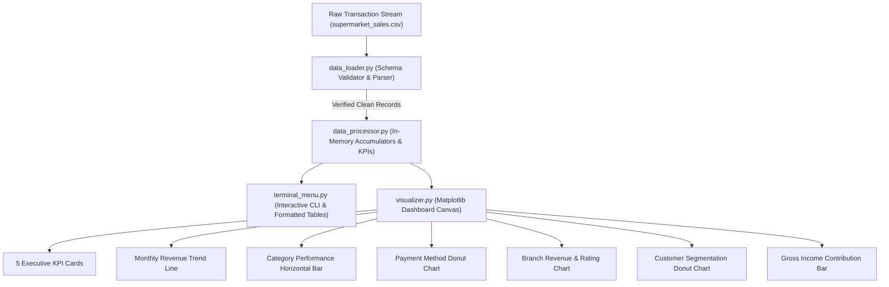

# RetailPulse 📊

[](https://www.python.org/)
[](https://matplotlib.org/)
[](tests/)
[](src/)

> An end-to-end retail sales analytics engine and executive command center engineered with core Python standard libraries and custom dark-themed Matplotlib data visualizations.

RetailPulse ingests historical multi-branch supermarket transaction records, validates schema constraints, computes high-dimensional business KPIs using standard-library hash tables, and delivers synchronized insights through an interactive terminal interface and an executive visual dashboard.

---

## Executive Analytics Dashboard


*Figure: Synchronized 2×3 analytical grid rendering monthly revenue trends, category volumes, payment method shares, branch comparisons, customer segmentation, and gross margins alongside 5 high-level executive KPI cards.*

---

## Engineering Highlights & Philosophy

- **Zero Heavy Data Science Dependencies:** All CSV parsing, type casting, schema validation, multi-dimensional grouping, and statistical aggregations are implemented using pure Python standard library primitives (`csv`, `datetime`, `collections`, `pathlib`). No Pandas or NumPy overhead.
- **$O(N)$ Streaming Ingestion:** Employs single-pass accumulator hash tables to calculate sales volume, revenue totals, tax splits, and gross profit metrics in linear time.
- **Dual Synchronized Interfaces:** Interactive CLI terminal menu with ASCII summary tables coupled with an object-oriented Matplotlib desktop analytics canvas.
- **Comprehensive Quality Assurance:** Verified by a 52-test automated unit and integration suite covering edge cases, corrupted rows, divide-by-zero protection, and headless rendering.

---

## System Architecture & Data Flow



### Module Responsibilities

- **`src/data_loader.py`:** Handles safe UTF-8/BOM streaming file ingestion, enforces 17-column schema contracts, casts types, and rejects malformed records.
- **`src/data_processor.py`:** Computes core retail metrics (Total Revenue, AOV, Gross Margin, Units Sold) and aggregates dimensional breakdowns without third-party frameworks.
- **`src/visualizer.py`:** Configures custom dark-navy canvas themes (`#0B1120`), custom `FancyBboxPatch` KPI metric cards, and 6 synchronized subplot axes using `GridSpec`.
- **`src/terminal_menu.py`:** Interactive menu-driven console providing instant text tables, sorting options, and live CSV reload capabilities.

---

## Technology Stack

| Layer | Technologies |
| :--- | :--- |
| **Language & Runtime** | Python 3.10+ (Verified on 3.10, 3.11, 3.12) |
| **Data Ingestion** | Python Standard Library (`csv.DictReader`, `pathlib`) |
| **Data Processing** | Pure Python Hash Tables (`dict`, `defaultdict`, `list`) |
| **Data Visualization** | Matplotlib 3.8+ (Object-oriented `Figure`, `GridSpec`, `Axes`) |
| **Testing Framework** | Python Standard Library (`unittest`, `unittest.mock`) |

---

## Dataset Schema

The platform is evaluated against 1,000 verified multi-branch supermarket transactions (`dataset/supermarket_sales.csv`) spanning January 1, 2019 to March 30, 2019:

| Column | Type | Description |
| :--- | :--- | :--- |
| `Invoice ID` | `str` | Unique transaction identifier |
| `Branch` / `City` | `str` | Branch identifier (`Alex`, `Cairo`, `Giza`) and municipal location |
| `Customer type` / `Gender` | `str` | Membership status (`Member`, `Normal`) and customer demographic |
| `Product line` | `str` | 6 retail merchandise categories |
| `Unit price` / `Quantity` | `float` / `int` | Unit price ($10.08–$99.96) and purchased volume (1–10 units) |
| `Tax 5%` / `Sales` | `float` | 5% value-added tax and total invoice revenue ($10.68–$1,042.65) |
| `Date` / `Time` | `date` / `str` | Timestamp of sale across standard operating hours |
| `Payment` | `str` | Payment method (`Ewallet`, `Cash`, `Credit card`) |
| `cogs` / `gross income` | `float` | Cost of goods sold and net gross income |
| `Rating` | `float` | Customer satisfaction rating (4.0–10.0) |

---

## Local Setup & Quick Start

### Prerequisites

- Python 3.10 or higher
- Git

### Installation

1. **Clone repository:**
   ```bash
   git clone https://github.com/Kartik-idk/RetailPulse.git
   cd RetailPulse
   ```

2. **Create and activate virtual environment:**
   ```bash
   python3 -m venv .venv
   source .venv/bin/activate
   ```

3. **Install dependencies:**
   ```bash
   pip install --upgrade pip
   pip install -r requirements.txt
   ```

4. **Launch interactive application:**
   ```bash
   python main.py
   ```

5. **Run with a custom dataset:**
   ```bash
   python main.py path/to/custom_sales.csv
   ```

---

## Automated Test Suite

RetailPulse includes a 52-test automated suite using Python's native `unittest` framework:

```bash
python -m unittest discover -s tests -v
```

### Coverage Breakdown

- **`tests/test_data_processor.py` (21 tests):** Schema validation, type conversion, boundary tests, negative quantity rejection, zero-division protection, and aggregation correctness.
- **`tests/test_visualizer.py` (9 tests):** Headless backend (`Agg`) chart generation, subplot axis verification, and empty record edge-case handling.
- **`tests/test_terminal_menu.py` (22 tests):** Interactive menu routing, formatted text tables, input sanitation, dataset reload, and missing-file recovery.

---

## Limitations & Future Roadmap

- **Quarterly Horizon:** Current sample records span 3 months; multi-year seasonality requires ingesting multi-file historical batches.
- **Display Server for GUI:** Interactive Matplotlib popups require a local desktop display manager (macOS Quartz, X11, Wayland). Headless environments support CLI tables and export mode.
- **Planned Roadmap:** Automated multi-page executive PDF report generation via `PdfPages` and native RFM (Recency, Frequency, Monetary) customer clustering algorithms.

---

## Documentation

- [Detailed Technical Report](docs/PROJECT_REPORT.md)
- [User Manual & Operation Guide](docs/USER_GUIDE.md)
- [Technical Architecture & FAQ](docs/VIVA_PREPARATION.md)
